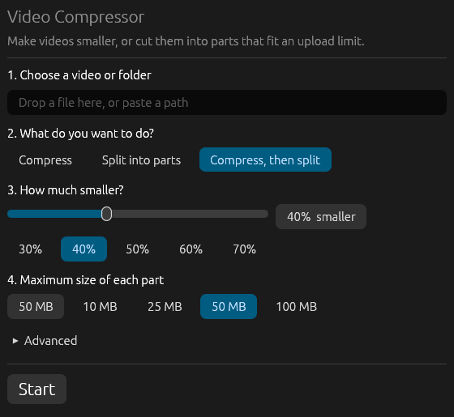

<p align="center"></p>

<h1 align="center">Video Compressor</h1>

<p align="center">
  <b>Shrink a video by a percentage, or cut it into upload-sized parts (like 50&nbsp;MB each) — in a few clicks.</b><br>
  A fast, friendly desktop app and command-line tool for Windows, Ubuntu/Linux and macOS. Built in Rust on top of ffmpeg.
</p>

<p align="center">
  <a href="https://github.com/itsabubakarshf/compressor/releases/tag/latest"><b>Download</b></a> ·
  <a href="SETUP.md">Step-by-step setup guide</a> ·
  <a href="#command-line">Command line</a>
</p>

<p align="center"></p>

## What it does

- **Make it smaller** — say "40% smaller" and it works out the right settings to land close to that size.
- **Cut it into parts** — split a long video into pieces that each stay under a size limit (default 50 MB), with no quality loss.
- **Or both** — compress first, then split only if it's still too big.
- **One file or a whole folder** (with sub-folders if you want). Your originals are never touched.
- **Easy** — drop a file on the window, pick what you want, press Start. Live progress and a Cancel button.
- **Fast** — H.264 or H.265, optional graphics-card encoding (NVIDIA / Intel / AMD), optional downscaling to 720p etc.

## Download

Get it from the **[Releases page](https://github.com/itsabubakarshf/compressor/releases/tag/latest)**:

| System | File | |
|---|---|---|
| Windows (recommended) | `VideoCompressor-Setup-windows.exe` | **Installer** — Start-menu shortcut, uninstaller, and it helps you set up ffmpeg |
| Windows | `VideoCompressor-portable-windows.exe` | **Portable** — just run it, nothing to install |
| Ubuntu / Linux | `compressor-linux` | |
| macOS (Apple Silicon) | `compressor-macos` | |

The app needs **ffmpeg** (the free video engine). On Windows it finds it for you or downloads it with one click —
details in **[SETUP.md](SETUP.md)**, which walks through Windows, Ubuntu and macOS step by step.

## Command line

Run with no arguments to open the window; give it a path to use the command line.

```powershell
# cut into parts of at most 50 MB (no quality loss, very fast)
compressor.exe "C:\Videos\holiday.mp4" --mode split

# make it about 40% smaller (a range like 30-50 aims for the middle)
compressor.exe "C:\Videos\holiday.mp4" --mode compress --reduce 40%

# 50% smaller, then cut into 25 MB parts if still too big
compressor.exe "C:\Videos\holiday.mp4" --reduce 50 --max-size 25MB

# a whole folder, including sub-folders
compressor.exe "C:\Videos" --recursive --reduce 40

# smaller + faster: 720p, H.265, GPU if available
compressor.exe "C:\Videos\holiday.mp4" --mode compress --height 720 --codec h265 --encoder auto
```

Results go to `compressor_out\` next to the input (change with `--output`). Parts are named
`name_part001.mp4`, `name_part002.mp4`, … Existing outputs are skipped unless you pass `--overwrite`.

| Option | Meaning |
|---|---|
| `-m, --mode` | `compress`, `split`, or `both` (default) |
| `-s, --max-size` | max part size, e.g. `50MB`, `1.5GB` (1 MB = 1,000,000 bytes, so parts are also under 50 MiB) |
| `--reduce` | make the video this much smaller: `40`, `40%`, or `30-50` (aims for the middle). Replaces `--crf` |
| `--crf` | quality, lower = better/bigger (default 26 for h264, 28 for h265) |
| `-o, --output` | output folder |
| `-r, --recursive` | include sub-folders |
| `--codec` | `h264` (default) or `h265` |
| `--preset` | x264/x265 speed preset, default `medium` |
| `--height` | downscale to at most this height (never upscales) |
| `--audio-bitrate` | default `128k` |
| `--encoder` | `cpu` (default, best quality per byte), `auto` (try GPU), `nvenc`, `qsv`, `amf` |
| `--ffmpeg` | path to ffmpeg if it isn't found automatically |
| `--setup-ffmpeg` | download and set up ffmpeg now, then exit (Windows) |
| `-y, --yes` | don't ask before downloading ffmpeg |

## How "make it X% smaller" works

The tool calculates the bitrate that gives `original size × (1 − X%)` and encodes to it (two passes on the CPU
encoder, so the result is accurate — typically within a couple of percent; GPU encoders use one pass and are
looser). Already heavily compressed videos can't always shrink a lot without looking bad; very high percentages
produce a warning.

## How splitting works

Split mode copies the streams (no quality loss, very fast), cutting at keyframes so each part is under the
limit. Because cuts land on keyframes, parts can be somewhat smaller than the limit. After cutting, every part's
size is checked; if one is too big the cut length is reduced and retried. If a video has too few keyframes to
cut small enough, the tool tells you and re-encodes with forced keyframes for that file instead.

Only the first video stream and all audio streams are kept (subtitles/data tracks are dropped).

## Development

```bash
cargo run                # opens the window
cargo test               # unit tests + end-to-end tests (need ffmpeg on PATH)
python3 tools/make_icon.py   # regenerate the icon (needs Pillow)
```

CI builds the Windows installer (Inno Setup), the portable exe, and the Linux/macOS binaries on every push and
publishes them on the Releases page.
